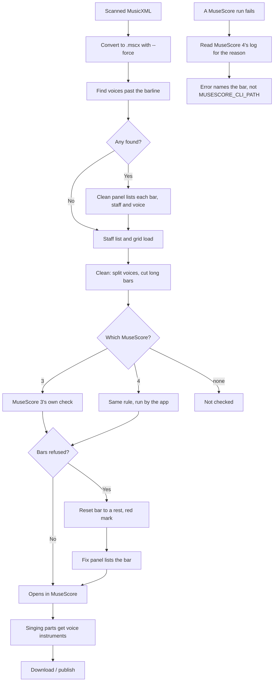

# MuseScore 4 and voices that run past the barline

How a scanned score gets past MuseScore 4 when one of its voices is longer than its
bar, and where the app names that bar. MuseScore 4 refuses such a file outright and
writes the reason only to its own log file; MuseScore 3 opens it and checks later.
The plan lets the raw scan in, names the bars at once, and has the clean cut or reset
them, so the cleaned score opens in MuseScore 4 without help.

## Colours

- **amber**: new or changed by this plan
- **teal**: what the person is told
- **rose**: notes taken out on purpose
- **blue**: as today
- **violet**: an outcome that says nothing was checked or something failed

## Boxes

- **Convert to .mscx with --force**: `pipeline.convert_to_mscx` passes `-f` so MuseScore 4 keeps an over-long voice instead of refusing the whole file. MuseScore 3 accepts the flag too.
- **Find voices past the barline**: new `clean_score/utils/overlong_voices.py`, the rule MuseScore 4 refuses by: a voice whose notes run past the bar's length. A short voice passes (MuseScore fills it with rests).
- **Clean panel lists each bar, staff and voice**: `GET /systems` returns `overlong` (`pipeline.overlong_in`, read off the converted file on every load, so a reload shows it too) and the Clean panel lists it above the grid; the clean's log names the bars again (`pipeline.log_overlong_voices`).
- **Same rule, run by the app**: `pipeline.musescore_check` uses the rule when the CLI is MuseScore 4, which writes no `.mlog`. Same `{measure, staff, voice, message}` shape, so the reset and the Fix panel work unchanged.
- **Reset bar to a rest, red mark**: `reset_rejected_bars`, as for MuseScore 3 today; the mark says MuseScore 4.
- **Singing parts get voice instruments**: new `clean_score/utils/voice_instruments.py`: `voice.soprano`, `voice.alto`, … on each singing part, so MuseScore 4 puts a new dynamic above the staff. The sound (program) is left alone. Comes in the second pull request of #481.
- **Read MuseScore 4's log for the reason**: `musescore_cli.failed_load_reason` reads the MuseScore 4 logs written during the run (Linux and macOS folders) for a "failed load notation" line stamped during the run and naming the file this run passed (a refusal naming no file is not used, since it may be another song's); `musescore_cli.explain` builds the error from them for the conversion, the renders and `export`.
- **Error names the bar, not MUSESCORE_CLI_PATH**: the path is blamed only when MuseScore did not start at all (said once, in `musescore_cli.run`, which every run goes through) or said nothing and logged nothing. `GET /systems` answers 422 with the error.
