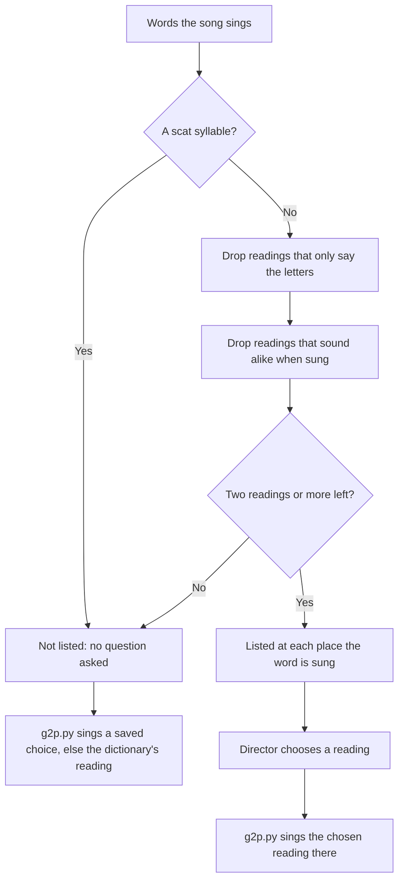

# The Pronunciation list

How the song page decides which sung words to ask about. A word is listed only when the dictionary
gives it two readings that a choir director could really choose between; everything else is sung
the dictionary's way with no question, unless a saved choice for it already exists: the list only
hides the question, it does not cancel a choice.

## Colours

- **blue**: reading the words and their dictionary readings
- **amber**: the questions that decide whether a word is listed
- **green**: what the director sees and does on the song page
- **teal**: what is sung

## Boxes

- **A scat syllable?**: `SCAT` in `src/sing_song/readings.py`: syllables whose readings are all real dictionary entries, so only a list can tell them. `re` and `ye` are left out of it on purpose.
- **Drop readings that only say the letters**: `spelled_out()` in `src/sing_song/readings.py`, for "da" as D-A or "us" as U-S. A one-letter word is left alone.
- **Drop readings that sound alike when sung**: `distinct()` in `src/sing_song/readings.py`.
- **Listed at each place the word is sung**: `api_pronunciation()` in `src/song_app/server.py`, drawn by `pronunciationSection` in `src/song_app/static/app.js`.
- **g2p.py sings the chosen reading there**: `english()` in `src/sing_song/g2p.py`.
- **g2p.py sings a saved choice, else the dictionary's reading**: the same `english()`. It looks for a choice saved for that place, then for the song, then for the choir, whether or not the word is listed, and only then falls back on the dictionary.
