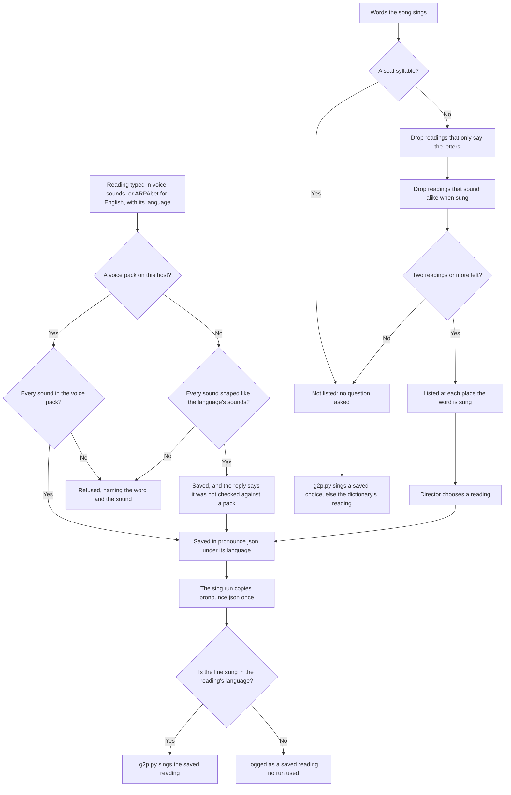

# The Pronunciation list

How the song page decides which sung words to ask about, and how a reading typed in the voice's
own sounds reaches the singer. An English word is listed only when the dictionary gives it two
readings a choir director could really choose between. A word in any language the singer reads can
also be given a reading by hand, saved with the language it is sung in, and only that language's
run uses it.

## Colours

- **blue**: reading the words and their dictionary readings
- **amber**: the questions that decide what is listed, kept or used
- **green**: what the director sees and does on the song page
- **violet**: where a saved reading is kept
- **teal**: what is sung, and what the run says

## Boxes

- **A scat syllable?**: `SCAT` in `src/sing_song/readings.py`: syllables whose readings are all real dictionary entries, so only a list can tell them. `re` and `ye` are left out of it on purpose.
- **Drop readings that only say the letters**: `spelled_out()` in `src/sing_song/readings.py`, for "da" as D-A or "us" as U-S. A one-letter word is left alone.
- **Drop readings that sound alike when sung**: `distinct()` in `src/sing_song/readings.py`.
- **Listed at each place the word is sung**: `api_pronunciation()` in `src/song_app/server.py`, drawn by `pronunciationSection` in `src/song_app/static/app.js`.
- **Reading typed in voice sounds, with its language**: the "reading in voice sounds" box in `pronunciationSection`. The language select lists every language g2p sings (`languages.sung_by_g2p()` in `src/sing_song/languages.py`) and defaults to the song's.
- **A voice pack on this host?**: `_pack_sounds()` in `src/song_app/server.py` reads `core/phonemes.json` under `UFR_DIR`, or finds none.
- **Every sound shaped like the language's sounds?**: with no pack, `_check_reading()` accepts a sound shaped `prefix/name` whose prefix is one of the language's (`languages.py` "prefixes"); English ARPAbet goes through as g2p checks it.
- **Saved, and the reply says it was not checked against a pack**: the reply's `note` (`NO_PACK`), shown under the new-reading box.
- **Every sound in the voice pack?**: the save route in `src/song_app/server.py` checks each sound against `core/phonemes.json` under `UFR_DIR`. ARPAbet is allowed for English only, never mixed with voice sounds. With no pack only the sound's shape is checked, and the reply says so.
- **Saved in pronounce.json under its language**: `places.save()` in `src/sing_song/places.py`: places carry `lang`, everywhere readings are `{lang: {word: sounds}}`. An entry with no language is English.
- **The sing run copies pronounce.json once**: `copy_pronounce()` in `src/sing_song/main.py`, so a save made mid-run waits for the next run.
- **Is the line sung in the reading's language?**: `main.py` runs `g2p.py` once per language per line; each run writes `<notes>.<lang>.used.json` listing the readings it applied.
- **Logged as a saved reading no run used**: `unused_readings()` in `src/sing_song/main.py`. Skipped under `--try`.
- **g2p.py sings the saved reading**: `english()` for an English ARPAbet reading, `deal()` in `src/sing_song/g2p.py` for voice sounds in any language.
- **g2p.py sings a saved choice, else the dictionary's reading**: the same `english()`. It looks for a choice saved for that place, then for the song, then for the choir, whether or not the word is listed, and only then falls back on the dictionary.
