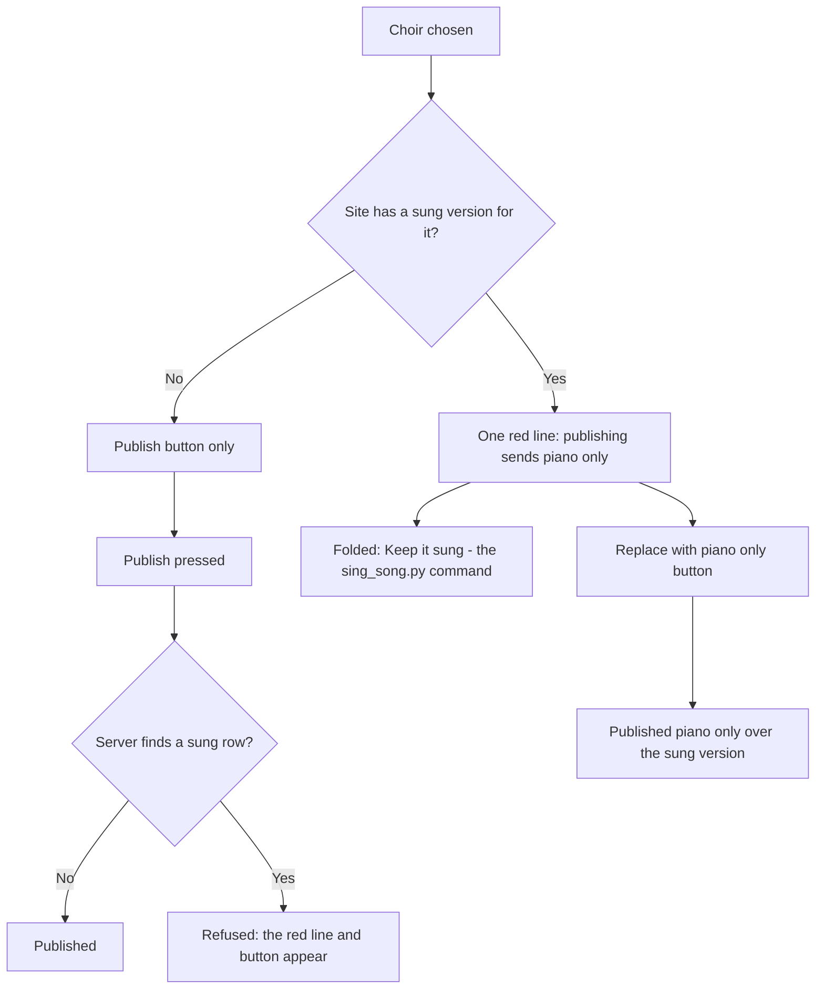

# Publish panel: a choir that already has a sung version

What the Publish panel shows once a choir is chosen, as changed by #500.
Nearly every live song is sung, so the warning is on screen for most songs; it
keeps it to one red line and a button, with the sing command folded away.

## Colours

- **amber**: changed by #500
- **rose**: replaces the sung version on the site
- **blue**: as today

## Boxes

- **One red line: publishing sends piano only**: `publishSection` in `static/app.js`, `sungText`. Red: `style.css` gives `.hint.err` the `--bad` colour (it had none, so it showed grey).
- **Folded: Keep it sung - the sing_song.py command**: `details.publish-keep-sung`; it was an always-open hint and a text box under the button.
- **Server finds a sung row?**: `publish.publish` reads the site's own row right before writing (#483) and answers 409 `sung_on_site`.
