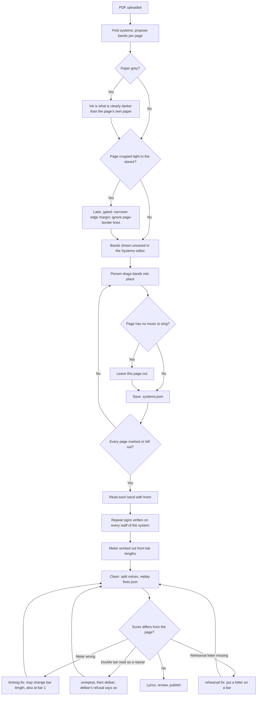

# Scanning a PDF into a score

How a song made from a PDF gets from its pages to a cleaned score, and where the
five planned scanning changes land. Blue boxes are what runs today; amber boxes are
the planned changes. A person decides at the violet boxes.

## Colours

- **blue**: what the app does today
- **amber**: a change planned on this card
- **violet**: a check, or a judgement a person makes

## Boxes

- **Find systems: propose bands per page**: `src/song_app/system_finder.py`, `page_systems` and `_joined`; joins two staves when one column of ink fills the gap between them.
- **Ink is what is clearly darker than the page's own paper**: #494, `system_finder._ink`. On a page whose median grey is 240 or darker, ink is below the paper's median by at least 10 levels or four times the paper's grain (never lighter than 230); a white page keeps the fixed 230. The spec named Otsu's method here; #494 uses this rule instead because Otsu lost faint staff lines, and the choice is with the owner.
- **Later, gated: narrower edge margin; ignore page-border lines**: a separate pull request that ships only once no hand-drawn page gets worse. The edge margin drops from 3% to 1% of the width, a join must also run through both staves, and a column inked through the page's top or bottom margin (a page border) is not a barline.
- **Leave this page out**: planned. `.systems.json` gains `skipped_pages`; `scan.pages_without_bands` stops counting those pages.
- **Every page marked or left out?**: `src/song_app/scan.py`, `pages_without_bands`; the Scan button stays off until it is empty.
- **Repeat signs written on every staff of the system**: `src/song_app/omr_systems.py`, `_system_barlines`; one staff reading a repeat puts it on all of them.
- **Meter worked out from bar lengths**: `src/song_app/omr_systems.py`, `_meter_plan`; homr cannot write a numerator, so it is inferred.
- **timesig fix: may change bar length, also at bar 1**: planned change to `score_fixes._set_timesig`, allowed only when every bar the signature governs already has the new length.
- **unrepeat, then delbar; delbar's refusal says so**: `score_fixes._delete_bar` refuses a bar with a repeat sign; the refusal will name `unrepeat`.
- **rehearsal fix: put a letter on a bar**: planned new kind in `score_fixes.py`; a RehearsalMark on the top staff at the start of the bar, replayed on every clean.
