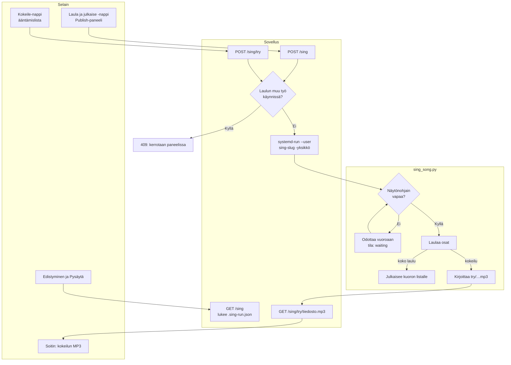

# Laulaminen choir appista

Miten Publish-paneelin "Laula ja julkaise" -nappi ja ääntämislistan "Kokeile"-nappi käynnistävät
saman `sing_song.py`:n kuin agentit, erillisenä systemd-ajona joka kestää sovelluksen uudelleenkäynnistyksen.
Näytönohjaimen lukko pitää huolen, että kerralla laulaa vain yksi ajo ja ajojen välissä on 60 s tauko.

## Colours

- **blue**: mitä ihminen näkee ja painaa
- **violet**: sovelluksen reitit ja ajon käynnistys
- **amber**: tarkistus ennen kuin mitään tehdään
- **rose**: odotus tai kieltäytyminen
- **green**: laulaminen ja sen tulos

## Boxes

- **systemd-run --user sing-slug -yksikkö**: `server.py` käynnistää `sing_song.py`:n omana systemd-yksikkönään (`sing-<slug>`), jotta automaattinen deploy-uudelleenkäynnistys ei katkaise laulua. Pysäytä = `systemctl --user stop`, jonka SIGTERM `sing_song` jo käsittelee.
- **Näytönohjain vapaa?**: uusi `flock` `sing_song`:ssa (`~/.local/state/musescore-choir-plugins/sing-card.lock`), sama agentin komentoriviajoille ja sovelluksen ajoille. Lukko vapautuu vasta 60 s ajon jälkeen.
- **GET /sing lukee .sing-run.json**: sama edistymistiedosto (`progress.py`), jota kirjastonäkymä jo näyttää.
- **Kirjoittaa try/…mp3**: `--try PART:A-B --out songs/<slug>/.sing-try`, käyttää tallennettuja ääntämisiä.
