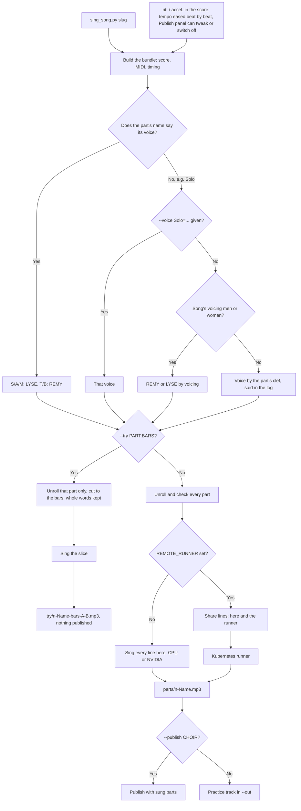

# A singing run

What `sing_song.py` does from a song to sung MP3s, with what #483 adds: a short trial run
(`--try PART:BARS`) that sings one phrase of one part and stops, the voice chosen for a part
whose name says no voice ("Solo"), and a printed rit. or accel. played as one. Also where a
line is sung: here, or on the machine `REMOTE_RUNNER` names.

## Colours

- **amber**: new in #483
- **blue**: what a run already does
- **teal**: what reaches the site
- **violet**: a question the run asks

## Boxes

- **Voice by the part's clef, said in the log**: new in `part_voice` (`src/sing_song/main.py`): bass or treble-8 clef sings REMY, treble LYSE. Before #483 the run stopped here.
- **Unroll that part only, cut to the bars, whole words kept**: new `--try` in `src/sing_song/main.py`; a word that starts inside the range is kept whole, so the slice may run a note or two past the last bar.
- **try/n-Name-bars-A-B.mp3, nothing published**: written under `--out`; no `parts/`, no `words.json`, no `.sing-run.json`, and `--publish` is refused with `--try`.
- **rit. / accel. in the score**: new `score.gradual_marks` / `add_gradual` in `src/score_export/score.py`; a rit. eases to 75% (accel. 125%) by the next 'a tempo', tempo change, fermata or the end; the Publish panel's list saves `publish.gradual` with a target BPM or 'off'.
