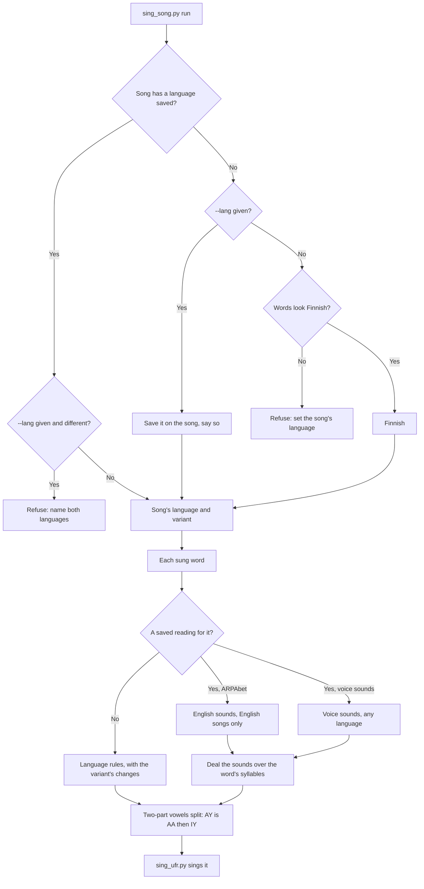

# How a song's language decides what is sung

The plan for eerovil/musescore-choir-plugins#484. The song keeps its language in its own file,
`language.json`, and every singing run reads it from there. Each syllable's sounds then come from a saved choice first,
in any language, else from the rules of the song's language and variant. English two-part vowels
are written as two vowels just before they are sung.

## Colours

- **blue**: what the run starts from
- **amber**: the questions that decide the language and the reading
- **rose**: the run stops before anything is sung
- **green**: the language the song is sung in
- **violet**: how a word's sounds are worked out (`g2p.py`)
- **teal**: singing

## Boxes

- **Song has a language saved?**: `songs/<slug>/language.json` (its own file, so an app job saving an older copy of `.song.json` cannot undo it), set on the New song form or the Start panel, or by the first `sing_song.py --lang` run.
- **--lang given and different?**: `sing_song.py --lang` now only confirms the saved language. `--change-lang` changes it.
- **Words look Finnish?**: a new check in `src/sing_song/main.py`, the reverse of `unmarked_finnish`: letters and pairs Finnish words seldom have (b, c, f, q, w, x, z, th, sh, ch, a lone g).
- **Language rules, with the variant's changes**: `src/sing_song/languages.py` lists each language and variant (`la` Italian church, `la-de` German style) and what a variant changes in its base's rules.
- **Voice sounds, any language**: a reading in `pronounce.json` written in the voice's own sound names (`de/h it/o it/d it/i it/e`), checked against the voice pack.
- **Two-part vowels split: AY is AA then IY**: English AY, AW and OY become two vowel sounds in `g2p.py`, the way the reporter wrote "child" by hand.
