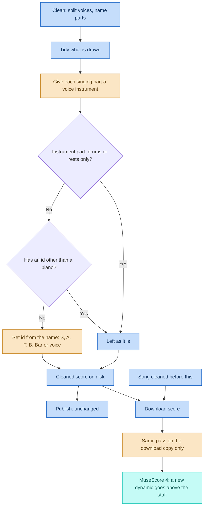

# Voice instruments for MuseScore 4

Why a dynamic added in MuseScore 4 lands on the words, and where the app gives each
singing part a voice instrument so it lands above the staff instead (#481).

## Colours

- **amber**: new in this pull request
- **teal**: what the person sees
- **blue**: as today

## Boxes

- **Give each singing part a voice instrument**: `clean_score/utils/voice_instruments.py`, `set_voice_instruments`, called last in both clean modes (`main._set_voice_instruments`).
- **Instrument part, drums or rests only?**: a part named as an instrument (`Piano RH`, `Violin`, `Urut`), percussion, and the rest-only click staff (`score_export.score.silent_parts`) are skipped.
- **Has an id other than a piano?**: an id someone chose (a flute, an alto voice) is kept. No id, MuseScore 3's `piano` and MuseScore 4's `grand-piano` are replaced.
- **Set id from the name**: `S1` → `soprano`/`voice.soprano`, A → alto, T → tenor, B → bass, `Bar` → baritone, any other name → `voice`/`voice.vocals`. The `Channel` and its `program` stay, so the sound and the MIDI do not change.
- **Same pass on the download copy only**: `pipeline.score_for_download`, used by `GET /score-file`. The stored score and its fingerprint are not touched, so nothing checked against it lapses.
- **MuseScore 4: a new dynamic goes above the staff**: pinned by `test_voice_instruments.py`'s MuseScore 4 test (skips without MuseScore 4). Dynamics already in an older score keep their side: MuseScore 4 writes it out when it converts the file.
- **Publish: unchanged**: the publish copy is left as it is (the owner's choice on #481).
